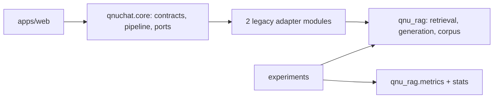

# Đánh giá chuyển qnu_rag sang v2 hay viết lại

Ngày kiểm tra: **05/11/2026**. Nguồn: `../qnu-admission-chatbot`, commit
`ab09b2a6ab0d19fc2286893230738d883f72694c` **cộng working tree chưa commit**.
Phần 1–7 là phân tích trước khi làm; kết quả thực hiện đợt lõi ở §8.

## 1. Kết luận

**Không chuyển cả repo. Dựng v2 sạch từ đầu, rồi chỉ chép vào những phần có trong danh sách ở
§3.1, kèm test của phần đó. Cái gì không có trong danh sách thì ở lại repo cũ.**

Mặc định là *không mang theo*: mỗi phần phải có lý do để được vào v2, thay vì có lý do để bị loại.
Lõi cần lấy khoảng 2.150 dòng, trong đó 378 dòng phải viết gọn lại; phần còn lại của 12.900 dòng
runtime và 13.255 dòng `experiments/` hoặc hoãn tới khi cần, hoặc bỏ.

Lý do không viết lại thuật toán: `qnu_rag` nhỏ, nhiều logic tất định đã có test. Lý do không chép
nguyên: code cũ trộn runtime với đánh giá, mang giả định pilot một PDF, và `contracts.py`,
`pipeline.py` vẫn giữ chỗ cho các hướng đã bỏ (§4.5). Repo cũ gắn tag làm kho lưu trữ để tái hiện
kết quả cũ, nên v2 không cần mang code chỉ để đọc lại pilot.

Nhận xét trước đó “thiếu qnu_rag/qnuchat” chỉ đúng với **checkout v2**. Trong repo nguồn,
`qnu_rag/` và `src/qnuchat/` đều tồn tại. Số 13 và 8 là số file v2 tham chiếu từng namespace,
có giao nhau; không được cộng thành 21 file khác nhau.

## 2. Bằng chứng từ code thật

Đếm tất cả file `.py`, kể cả `__init__.py`; số dòng gồm comment và dòng trống, không phải độ phức tạp.

| Phần trong repo cũ | File Python | Dòng | Ý nghĩa |
|---|---:|---:|---|
| `qnu_rag/` | 15 | 874 | Lõi pilot nhỏ, đủ đọc và chuyển theo từng module |
| `src/qnuchat/core/` | 24 | 2.302 | Nền pipeline đã có; không cần thiết kế lại từ số 0 |
| `src/qnuchat/ingest/` | 15 | 2.626 | Luồng thu thập riêng, không thuộc phạm vi chép qnu_rag |
| `apps/` | 58 | 7.128 | Web, crawler, knowledge base; chuyển riêng theo nhu cầu |
| `tests/` | 141 | 21.433 | Tài sản kiểm chứng cần đi cùng code; không đồng nghĩa mọi yêu cầu mới đã được kiểm |

AST cho thấy chỉ **2 file trong `src/qnuchat` import trực tiếp `qnu_rag`**:
`core/adapters/legacy_qnu_rag.py` và `core/adapters/legacy_runtime.py`. `apps/` có 0 file import
trực tiếp; `experiments/` có 13; `tests/` có 24. Đây là điểm chuyển giao khá tập trung.
38 file Python trong `experiments/` của v2 hiện giống byte-for-byte với bản cũ.



Sơ đồ là quan hệ phụ thuộc cấp module hiện có; không khẳng định mọi nhánh đều chạy ở mỗi lượt chat.
CodeGraph trả source hiện tại; Graphify cũ hỗ trợ tìm quan hệ nhưng có dòng nguồn cũ nên số dòng
trong đánh giá được đối chiếu lại bằng CodeGraph. Fingerprint 43 file liên quan nằm trong
[bản chụp SHA-256](legacy-source-fingerprints-2026-11-05.json).

## 3. Phần có giá trị nên giữ

| Thành phần | Bằng chứng | Hướng chuyển |
|---|---|---|
| BM25 tiếng Việt, giữ token một ký tự | [index.py](../../../qnu-admission-chatbot/qnu_rag/index.py), `_tokenize`, dòng 17 | Giữ hành vi và test; đưa vào `core/retrieval/bm25.py` |
| Dense search và chuẩn hoá vector | `index.py`, `DenseIndex`, dòng 121 | Giữ làm backend in-memory để test/baseline; chưa thay bằng DB trong cùng bước |
| RRF và tie-break tất định | `index.py`, `rrf_depth`, `rrf_fuse`, dòng 147–170 | Giữ công thức, độ sâu và thứ tự; đưa vào `core/retrieval/fusion.py` |
| Pin revision và kiểm thiết bị embedding | `index.py`, `BGEEmbedder`, dòng 80 | Chuyển wrapper sang adapter; giữ fail-fast khi yêu cầu CUDA mà không có |
| Lỗi generator không biến thành từ chối | [generate.py](../../../qnu-admission-chatbot/qnu_rag/generate.py), `answer`, dòng 128 | Giữ schema validation, raw response và test lỗi; tận dụng adapter đang có |
| Bootstrap theo source family | [stats.py](../../../qnu-admission-chatbot/qnu_rag/stats.py), dòng 10 | Giữ trong `qnuchat.eval.stats`; xác định rõ estimand và thêm kiểm input rỗng/tham số khi chuyển |
| Contract, trace, ports, pipeline | [core](../../../qnu-admission-chatbot/src/qnuchat/core) | Giữ ý tưởng và ports; viết gọn `contracts.py`, `pipeline.py`, bỏ phần ở §4.5 |
| Hash dữ liệu và run identity | [provenance.py](../../experiments/provenance.py) | Tái sử dụng trong eval; giữ chặn chấm output bằng gold/corpus khác |

Viết lại các phần này dễ mất các chi tiết nhỏ đã có test: token số một ký tự, tie-break RRF,
revision model, phân biệt lỗi hạ tầng với abstention và nhóm phụ thuộc trong bootstrap.

### 3.1 Danh sách lấy, viết mới, hoãn, bỏ

Phân loại theo quyết định đã ghi trong `docs/README.md`, hàng đợi việc, spec paper v2 §4.0 và
RUNBOOK chạy từ đầu của repo cũ, cùng phân tích import từ các điểm vào `apps/`. Số dòng tính cả
comment và dòng trống.

| Quyết định | Thành phần | Dòng | Ghi chú |
|---|---|---:|---|
| **Lấy, giữ hành vi** | `qnu_rag/index.py`, `generate.py`, `stats.py`, `metrics/{retrieval,abstention,slots,_numbers}.py` | 569 | Tách file theo thuật toán, chép test |
| **Lấy, giữ hành vi** | `core/{ports,errors,snapshot,config,catalog,text}.py`, `core/stages/*`, adapter `embedding_cache`, `notice_writer`, `vllm`, `digest` | 848 | Gỡ phần ở §4.5 khi chép |
| **Lấy, giữ hành vi** | `core/rewrite.py` | 354 | Arm M2 vẫn cần; luật thành baseline và ca kiểm thử cho model hiểu câu |
| **Lấy, giữ hành vi** | `experiments/{provenance,sources,snapshot_v2,prepare_gold,prepare_dialogs,review_hub}.py` | 1.115 | Công cụ gold còn dùng. `prepare_gold` chỉ cần `docx_lines`, `html_lines` từ `bench_baseline_gap`: tách hai hàm này, không kéo cả script |
| **Viết gọn lại** | `core/contracts.py`, `core/pipeline.py` | 378 | Giữ contract `Query → Answer + Trace`, bỏ chỗ dành cho hướng đã bỏ |
| **Viết mới** | `qnu_rag/schema.py`, `corpus.py`, `chunking.py`, hai adapter `legacy_*` | 471 | Hết giả định một PDF; adapter `legacy_*` biến mất vì không còn lớp `qnu_rag` để bọc |
| **Viết mới khi có rubric** | `metrics/faithfulness.py`, `completeness.py` | 90 | Theo rubric v2 (§4.3); chưa viết vì rubric chưa chốt |
| **Hoãn, lấy khi tới việc** | `apps/web` và `web-ui` | 4.779 + UI | Sản phẩm đang chạy, không phải phần bỏ; lấy sau khi lõi xong. Gộp migration `0001`–`0007` thành một bản đầu |
| **Hoãn, lấy khi tới việc** | `segments_generator.py`, `segments_prompt.py` | 414 | Cờ `inline_citations` đang tắt, chờ đo |
| **Lấy, giữ hành vi** (Kent đổi 06/11/2026, xem §10) | `ingest`, `apps/crawler` | 3.419 | Thay quyết định 05/11 "ở lại repo cũ": RUNBOOK v2 không còn chạy gì ở repo cũ |
| **Hoãn, lấy khi tới việc** | `apps/knowledge_base` | 1.555 | Lọc chủ đề bằng model, ảnh người, dựng snapshot; RUNBOOK mục 5 và 11 |
| **Hoãn, chỉ lấy một đường** | `experiments/ocr_selection/` | 4.097 | M8 đã chọn `cur_rotgate`; khi OCR kho web chỉ tách đường chạy cấu hình đó, 62 trang đã OCR dùng lại output |
| **Tham khảo khi làm SQL** | `experiments/bench_sql_vs_text.py` | 420 | Parser bảng điểm dùng cho V5a; không chép cả script |
| **Bỏ** | `qnu_rag/arms.py`, các script pilot `run_pilot`, `report_pilot`, `preflight_pilot`, `pilot_readiness`, `probe_generator` | 1.116 | B0–B3 không có trong 17 arm; runner mới theo plan P1 |
| **Bỏ** | `draft_gold_v2_core.py`, `draft_gold_v2_comparison.py` | 1.995 | RUNBOOK cấm chạy lại vì ghi đè file nháp đã sửa tay |
| **Bỏ** | `bench_{baseline_gap,inline_citations,ocr,rag_type,retrieval,vectorstore}`, `data_inventory`, `eval_multiturn`, `gap_questions`, `ocr_table`, `ocr_validation`, `probe_pdf_images`, `render_pages`, `spike_gpu_share` | 4.562 | Thí nghiệm đã xong hoặc được runner mới thay; số liệu nằm ở `results/` repo cũ |
| **Bỏ khi có M3** | `apps/web/smalltalk.py` | 82 | Regex xã giao đã bị thay bằng model hiểu câu; giữ tới khi spec B xong nếu cần chat chạy trước |

## 4. Phần phải sửa trước khi dùng cho v2

### 4.1 Schema và corpus đang mang giả định pilot

- [schema.py](../../../qnu-admission-chatbot/qnu_rag/schema.py) chứa cả `Page/Chunk/Answer`
  và `GoldItem/ExpectedSlot` trong cùng file. Tách kiểu runtime sang core, gold/rubric sang eval.
- `Chunk` có `page`, `text`, `source_year` nhưng chưa có định danh nguồn đa tài liệu đầy đủ.
  Tái sử dụng `Passage`/contract hiện có của qnuchat, rồi bổ sung provenance theo yêu cầu;
  tránh duy trì hai kiểu `Answer` độc lập lâu dài.
- [corpus.py](../../../qnu-admission-chatbot/qnu_rag/corpus.py), dòng 10–18, mặc định Cẩm nang
  2025 và loại trang `{1, 2, 3, 107, 108}`; cùng file còn có `load_gold`.
  Tách đọc tài liệu sang ingest, đọc gold sang eval, loại trang thành cấu hình từng nguồn.

### 4.2 Chunk ID và giới hạn chiều dài cần thiết kế lại

[chunking.py](../../../qnu-admission-chatbot/qnu_rag/chunking.py), dòng 34–54, sinh `p001`,
`p001a`, `p001b`. Hai PDF đều có trang 1 sẽ trùng ID nếu gộp trực tiếp; RRF hiện gộp theo
`chunk_id`, vì vậy đây là rủi ro dữ liệu cụ thể. Dùng ID có `source_id`, locator và thứ tự chunk; phiên bản nội dung nằm trong Snapshot (§8). Không đổi ID âm thầm cho run đã lưu.

Hàm chỉ chia đôi một lần khi vượt `max_chars`, nên không đảm bảo mọi phần đều dưới giới hạn
(ví dụ một trang 10.000 ký tự, giới hạn 1.500). V2 cần thuật toán chia lặp hoặc theo token,
có test giới hạn, tính ổn định và truy ngược nguồn. Đây là hành vi cần sửa có chủ đích,
không nằm trong bước kiểm kết quả tương đương pilot.

### 4.3 Metric pilot không đủ cho đánh giá mới

- [faithfulness.py](../../../qnu-admission-chatbot/qnu_rag/metrics/faithfulness.py), dòng 55–71:
  `citation_precision` đếm ID tồn tại trong context; không chứng minh câu được nguồn hỗ trợ.
  `citation_recall` chỉ nhận ID dạng `pNNN[a-z]?`, không đủ cho nhiều tài liệu.
- `unsupported_claims` dò số trong nguồn được dẫn: hữu ích làm một kiểm tra, nhưng một số
  xuất hiện trong nguồn không chứng minh đúng ngành, đợt hay phương thức.
- [completeness.py](../../../qnu-admission-chatbot/qnu_rag/metrics/completeness.py), dòng 10–19,
  kiểm substring của điều kiện; chưa kiểm đầy đủ phủ định hoặc quan hệ AND/OR.
- `slots.py` khớp subject/predicate/value/unit/year tương đối chặt, nên giữ helper; thiết kế
  rubric v2 vẫn phải xử lý đợt, phương thức và quan hệ so sánh theo protocol.

Các giới hạn cũng được ghi nhận trong [audit gold 18/10](../../benchmarks/v2/review/review-2026-10-18.md).
Muốn đọc lại hoặc tái hiện kết quả pilot thì dùng tag ở repo cũ; v2 không mang metric pilot.
Metric mới trong v2 phải có tên hoặc version riêng để không nhầm với số pilot.

### 4.4 Arms và wiring

`arms.py` chỉ có B0–B3. Không coi việc chuyển file này là đã triển khai ma trận 17 arm.
Chuyển runner/arm phục vụ thí nghiệm sang eval; runtime phục vụ web gọi core.
Hai legacy adapter không chuyển sang v2; logic thật của chúng đi thẳng vào adapter mới.

### 4.5 Dấu vết của các hướng đã bỏ trong contract

Đây là lý do không thể chép nguyên `qnuchat.core`, dù nó đã có test:

- `STAGE_NAMES` có 12 stage. `temporal_policy`, `authority_policy`, `rules`, `completeness`,
  `verification` thuộc các hướng đã bỏ hoặc hoãn thành future work: **bỏ**.
- `query_understanding`, `routing`, `abstention_gate` cũng đang là `DisabledStage`, nhưng còn việc
  thật (V5a, V5b): chỉ thêm khi triển khai, không tạo chỗ trống trước.
- `AbstainSource` có `completeness_gate`, `verifier`: đổi theo cổng từ chối tất định mới.
- `Query.user_facts` phục vụ rule engine đã hoãn: bỏ.
- `projection_hashes` với `sql`, `rules` luôn `None` là tàn dư ledger/dual projection: thay bằng
  hash thực sự có. `Trace.asked_at` giữ vì cần để replay.

Plan P1 cũ cũng đã bỏ các cờ này khi viết lại Task 6–7 ngày 04/11/2026. Trace của v2 vì thế khác
trace cũ; kiểm tương đương dựa trên kết quả retrieval, prompt và phân loại lỗi, không so toàn bộ trace.

## 5. So sánh lựa chọn

| Lựa chọn | Lợi ích | Chi phí/rủi ro | Đánh giá |
|---|---|---|---|
| Chép nguyên `qnu_rag` | Nhanh phục hồi phần import pilot | Vẫn thiếu qnuchat/config; giữ schema trộn, ID một PDF, metric cũ | Chỉ phù hợp cầu nối tạm để tái hiện pilot |
| Viết lại tất cả | Toàn quyền định hình | Phải khôi phục hành vi và test; thay quá nhiều biến cùng lúc; rủi ro lệch baseline | Không có đủ bằng chứng để chọn |
| Dựng mới, chép theo danh sách §3.1 | Giữ thuật toán/test tốt; code của hướng đã bỏ không có đường vào v2 | Cần duyệt danh sách và kiểm tương đương | **Khuyến nghị** |

Chỉ nên chọn viết mới hoàn toàn nếu đổi căn bản yêu cầu/runtime hoặc phần lớn code không thể
kiểm chứng và không thể tách. Bằng chứng hiện có chưa cho thấy các điều kiện đó.

## 6. Cách chuyển để không rối lần nữa

1. Khoá nguồn: commit các thay đổi còn dở ở repo cũ, gắn tag lưu trữ, ghi manifest SHA-256.
   Không mặc định `git archive HEAD` chứa thay đổi hiện tại của `index.py` và lockfile.
2. Tạo packaging v2 bằng uv, `src/qnuchat`, nhóm dependency rõ ràng và test kiến trúc.
   Chưa thay thuật toán hoặc nâng version trong bước này.
3. Viết gọn contracts, ports, errors và chép retrieval primitives kèm test. So sánh thứ tự
   retrieval, score, prompt, schema và phân loại lỗi trên fixture cố định.
4. Chép generator, embedding adapter và dựng pipeline chỉ với các stage có thật. Không tạo cầu nối
   `qnu_rag`, không có package `qnu_rag` trong v2.
5. Chép gold schema, metric còn dùng, stats và công cụ gold vào `qnuchat.eval`.
   Sau đó mới viết corpus đa nguồn, chunk ID, router SQL và rubric mới theo từng yêu cầu.
6. Chỉ lấy phần ở nhóm *Hoãn* khi tới việc cần nó. `apps/web` và `web-ui` là đợt riêng sau lõi.
7. Build wheel rồi test import từ ngoài repo để tránh `pythonpath=["src", "."]` che lỗi đóng gói;
   chạy baseline regression và một lượt live riêng.

Mỗi đợt phải có đường dẫn nguồn → đích, test đi kèm, dependency cần thêm và điều kiện hoàn tất.
Không dùng `sys.path.insert` hoặc import chéo sang thư mục repo cũ để làm v2 “chạy được”.

## 7. Kiểm chứng và giới hạn

Đã đọc AST, dùng CodeGraph/Graphify và đối chiếu code ở các điểm nêu trên.
**402 passed trong 45,36 giây** khi chạy các test hiện có bằng uv trong repo cũ:

```bash
uv run --no-sync pytest -q -p no:cacheprovider \
  tests/test_schema.py tests/test_chunking.py \
  tests/test_index_bm25.py tests/test_index_dense.py tests/test_index_hybrid.py \
  tests/test_generate.py tests/test_arms.py \
  tests/test_metrics_abstention.py tests/test_metrics_completeness.py \
  tests/test_metrics_faithfulness.py tests/test_metrics_retrieval.py tests/test_metrics_slots.py \
  tests/test_stats.py tests/test_provenance.py tests/core tests/arch
```

Log local: `artifacts/audit/legacy-tests.log` trong v2 (được ignore, không phải tài liệu cần commit).
Không viết test mới hoặc sửa code nguồn trong lần đánh giá.

Đã chạy thêm probe nhỏ bằng dữ liệu giả, không gọi model/DB, để xác nhận giới hạn pilot:

| Probe | Kết quả thực tế |
|---|---|
| Trang 10.000 ký tự, `max_chars=1500` | Hai chunk dài 5.000 ký tự |
| Hai nguồn khác nhau đều có trang 1 | Cùng sinh ID `p001` |
| Câu trả lời không liên quan nhưng dẫn ID có trong context | `citation_precision = 1.0` |
| Citation `srcA:p001`, gold page `[1]` | `citation_recall = 0.0` vì ID không khớp pattern pilot |

Đây là bằng chứng cần đổi contract/metric cho v2; không gọi các hành vi đúng phạm vi pilot
là lỗi triển khai của pilot.
Đây không phải audit toàn bộ hệ thống: chưa chạy GPU/vLLM, chưa đo chất lượng RAG, chưa xác nhận
migration DB hay UI trong v2. Test pass xác nhận hành vi hiện có, không chứng minh rubric mới đúng.

Thiết kế đích: [folder-structure.md](folder-structure.md). Phiên bản và quản lý bằng uv:
[tech-stack-audit.md](tech-stack-audit.md).

## 8. Kết quả đợt lõi (05/11/2026)

Nguồn khoá ở tag `v1-final` (`83a8d26`, nhánh `archive/v1-truoc-v2` của repo cũ), lúc khoá có
1.720 test pass, 82 skip. Nguồn → đích từng file ở
[manifest](migration-manifest-v1-final.json). `qnu_rag/` không còn trong v2; 49 file bỏ khỏi v2 được
đối chiếu từng byte với tag trước khi xoá.

| Kiểm chứng | Kết quả |
|---|---|
| Test, ruff, import contract | 377 passed, 9 skipped; ruff sạch; 4 contract đạt |
| So với code cũ trên Cẩm nang 2025 | 103 trang, 126 passage, thứ hạng và điểm BM25/dense/RRF, nguyên văn prompt đều khớp |
| So với code cũ bằng BGE-M3 thật, CUDA | 8 câu hỏi, 16/16 bảng xếp hạng giống hệt, chênh lệch điểm bằng 0 |
| Test so sánh có bắt được sai lệch không | 6/6 lần cố ý sửa thuật toán, prompt, schema đều đỏ |
| Wheel | Build được, import được từ ngoài repo, không chứa `qnu_rag`, `experiments`, `tests` |
| `uv.lock` | Giữ nguyên phiên bản của mọi gói còn dùng; 112 → 90 gói |

Khác biệt so với kế hoạch:

- **Chunk ID** là `<source_id>:p001` hoặc `<source_id>:p001-2`, không chứa phiên bản nội dung, vì
  model phải chép lại ID khi trích dẫn. Phiên bản nguồn nằm trong Snapshot.
- **Prompt khác v1 ở ID dài hơn `p001`** và ở bản sửa câu trả lời rỗng (§9). Đo 40 câu: 0 ID không
  tồn tại, trích đúng trang gold 26 so với 27 của ID ngắn, nên giữ ID dài.
- **Chưa viết** metric faithfulness và completeness vì rubric v2 chưa chốt.
- `Citation`, `Claim.evidence_ids`, `Clock`, phần `segments` bị gỡ khỏi contract vì chưa có code dùng;
  thêm lại cùng đợt web app hoặc trích dẫn theo đoạn.

Còn hở:

- **Chất lượng trả lời chưa đạt:** sau khi sửa câu rỗng vẫn còn sai ngành, lẫn số và bịa thông tin; xem §9.
- `environments/vllm` dựng lại môi trường vLLM của repo cũ: không gói nào đổi phiên bản, thiếu
  `nvidia-cuda-nvdisasm` và `openai-harmony` vì vLLM không khai chúng. 3 câu × 2 arm cho câu trả lời
  và số token giống hệt môi trường cũ.
- `eval/metrics/retrieval.py` so theo số trang, chưa đủ cho nhiều nguồn; gold v2 đã có
  `gold_evidence` dạng `[nguồn, trang]`, nên phải đổi khi viết runner.
- `experiments/review_hub.py` đọc spec paper v2 chưa có trong v2, nên chưa chạy được; 2 test đang skip.
- 7 test `test_gold_validity.py` skip vì chưa có `benchmarks/pilot/gold.jsonl`.

## 9. Câu trả lời rỗng (06/11/2026, đã sửa)

`SYSTEM_PROMPT` không định nghĩa `answer`, và schema đặt `abstain_reason` trước `answer`. Model viết
`"abstain_reason":""` rồi `"answer":""`, còn thông tin đúng nằm trong `claims`. Kết quả v1 cũng có
hiện tượng này với tỉ lệ khác nhau: 39/108 ở M5 hybrid, 45/388 ở M7 a2.

Thử trên 20 câu, Qwen3-4B-AWQ, chỉ đổi một biến ở mỗi dòng; gold còn là bản nháp:

| Biến thể | Rỗng hoặc rác | Có nội dung | Từ chối đúng |
|---|---:|---:|---:|
| Gốc | 14 | 2 | 3/4 |
| Thêm quy tắc định nghĩa `answer` | 0 | 16 | 3/4 |
| Đưa `abstain_reason` xuống cuối schema | 0 | 16 | 3/4 |
| Cả hai | 0 | 16 | 3/4 |

Đã áp dụng cả hai: thêm quy tắc 7 vào `SYSTEM_PROMPT` và đưa `abstain_reason` xuống cuối schema.
System prompt và schema vì thế khác v1, nên số đo v1 không còn so trực tiếp được và baseline phải
chạy trên bản này. `tests/core/test_pilot_parity.py` giữ nguyên phần so với v1 cho truy hồi và prompt
người dùng, và ghi giá trị v2 cho hai phần vừa đổi.

Trước khi sửa, cấu hình `b3-chat` biến câu rỗng thành câu báo "chưa có thông tin" dù model đã tìm
đúng số liệu.

Sau khi sửa, chạy 40 câu × 2 arm bằng code chính (`artifacts/runs/live-20261106-011838`): 0/80 lượt
rỗng, từ chối đúng 6/8 ở mỗi arm, 1 câu mỗi arm bị cắt do `max_tokens` 1024. Đọc tay arm ID dài trên 32
câu trả lời được, so với đáp án nháp: 25 đúng, 5 sai, 1 chưa rõ, 1 bị cắt. Đây không phải số báo cáo.

Lỗi còn lại, không liên quan câu rỗng:

| Loại | Câu | Hướng xử lý |
|---|---|---|
| Viết tắt, không dấu làm truy hồi sai ngành | `V2-PIL-067` QTKD, `V2-PIL-068` AI, `V2-PIL-066` ô tô | Danh mục bí danh, lọc ngành (V5a, V5b) |
| Lẫn số giữa các ngành | `V2-PIL-001`, `V2-PIL-010` | SQL cho số liệu (V5a) |
| Trả lời câu phải từ chối | `V2-PIL-050` học bổng 2026 | Cổng từ chối theo năm (V5a) |
| Bị cắt | `V2-PIL-022` | `max_tokens` 2048 theo D6 |

## 10. Chuyển crawler (06/11/2026)

Kent yêu cầu RUNBOOK không còn chạy gì ở repo cũ, nên crawler vào v2 theo mapping ở
[folder-structure](folder-structure.md): nghiệp vụ ở `qnuchat.ingest`, dòng lệnh ở `apps/cli/crawl.py`.
Nguồn → đích ở [manifest](migration-manifest-crawler-2026-11-06.json). Bản chép là working tree, không
phải tag `v1-final`, vì `topic_gate` chưa commit ở repo cũ.

| Khác với repo cũ | Lý do |
|---|---|
| `PostgresCrawlLog` thành `FileCrawlLog` (`crawl_runs.jsonl`, `fetch_log/`) | v2 chưa có database; `CrawlLog` đã là Protocol nên job không đổi. `status` thêm số MB đã tải |
| `prune` bỏ nhánh `off_topic`, bỏ lệnh `prune-people` | Cần `apps/knowledge_base`, chưa chuyển |
| Log ở `artifacts/logs/` | Theo cây thư mục v2 |

15 file `ingest` và `configs/crawl/qnu.yaml` giữ nguyên từng byte so với bản 01:33 ngày 06/11/2026.
Sau mốc đó sửa crawler ở v2, repo cũ không còn là nguồn. Thư viện thêm vào nhóm `ingest` giữ đúng phiên
bản trong lockfile cũ.
